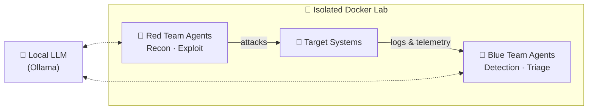

# 👋 Hi, I'm Raffi (Mr-Robotiko)

### Hacker by heart - "breaking systems to make them safer"

<!-- Add your contact badges here (they appear centered under the title), e.g.:

-->

---

## 🎯 What I Do

I work in **offensive security**. I find vulnerabilities before attackers do, and I like building my own tooling along the way.

- 🔓 **Penetration Testing**: web applications, networks and Active Directory, from recon to reporting
- 🤖 **AI in Security**: researching the AI arms race across offensive, defensive and regulatory perspectives.
- 🛠️ **Security Tooling**: building toolkits and references that make security work faster and more accessible

> [!NOTE]
> **Currently working on:** an isolated Red vs. Blue lab where LLM agents attack and defend, measuring detection rate, false positives and time-to-detect.

---

## 📌 Selected Repositories

| Repository | Description |
| ---------- | ----------- |
| [**Gilfi**](https://github.com/Mr-Robotiko/Gilfi) | Security & network analysis toolkit (PyQt6 + Flask) with port scanner, hash cracking, password analysis and a local AI assistant via Ollama |
| [**Pentest-Cheatsheet**](https://github.com/Mr-Robotiko/Pentest-Cheatsheet) | Command-ready pentest reference with live variables: set target IP & creds once, and every command fills itself in · [Live site](https://mr-robotiko.github.io/pentest-cheatsheet/) |

<b>📂 More projects</b>

 

| Repository | Description | Stack |
| ---------- | ----------- | ----- |
| [**cryptography**](https://github.com/Mr-Robotiko/cryptography) · [**krypto-code-abgabgen**](https://github.com/Mr-Robotiko/krypto-code-abgabgen) | Cryptographic algorithms & exercises | Python |
| [**studyflow**](https://github.com/Mr-Robotiko/studyflow) | Web engineering project | PHP |
| [**Studentenverwaltung_C_DHBW**](https://github.com/Mr-Robotiko/Studentenverwaltung_C_DHBW) | Student management system | C |
| [**Loginsystem-mit-integriertem-Spiel**](https://github.com/Mr-Robotiko/Loginsystem-mit-integriertem-Spiel) | Login system on MS SQL Server that unlocks a game | C# |
| [**BreakOut**](https://github.com/Mr-Robotiko/BreakOut) · [**GameLauncher-Projekt**](https://github.com/Mr-Robotiko/GameLauncher-Projekt) | Classic game & launcher | C# |
| [**Weather-App-Angular**](https://github.com/Mr-Robotiko/Weather-App-Angular) | Weather app on the OpenWeatherMap API | Angular / TS |
| [**ToDo-App-React**](https://github.com/Mr-Robotiko/ToDo-App-React) | To-do app | React / TS |

## 🧰 Tech Stack

**Offensive Security**

**Languages**

**Frameworks & Web**

**Platforms, AI & Databases**

---

## 🤝 Let's Connect

Always happy to exchange ideas:

- 🔐 **Security folks?** Let's talk about pentesting methodology, AD attacks, CTFs or tooling.
- 🤖 **Into AI?** I'm interested in LLM agents for offensive and defensive security, local models and detection engineering.
- 💻 **Developer?** Happy to discuss secure-by-design architecture or how your app would hold up in a pentest.

Feel free to open an issue on any of my repositories.

> [!WARNING]
> All offensive tooling and content in my repositories is intended for **authorized testing and education only**. Never use it against systems you don't have explicit permission to test.

---

<picture>
  <source media="(prefers-color-scheme: dark)" srcset="https://github-readme-stats.shion.dev/api?username=Mr-Robotiko&theme=github_dark&hide_border=true&bg_color=00000000" />
  
</picture>
<picture>
  <source media="(prefers-color-scheme: dark)" srcset="https://github-readme-stats.shion.dev/api/top-langs/?username=Mr-Robotiko&theme=github_dark&hide_border=true&layout=compact&bg_color=00000000" />
  
</picture>

